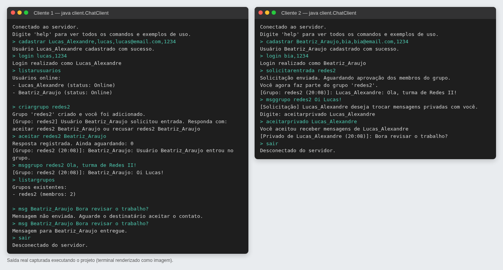

# 📡 ChatRedes

Sistema de **chat cliente-servidor via terminal**, em **Java com Sockets TCP e Threads**. O servidor atende vários clientes ao mesmo tempo (uma thread por conexão) e oferece cadastro e login de usuários, status, mensagens privadas com aceite, grupos com convite e aprovação dos membros, e entrega de mensagens pendentes. Os dados de usuários e grupos ficam em um banco **SQLite** (JDBC).

Trabalho da disciplina **Redes de Computadores II** (Unoeste), orientado pelo Prof. Robson Siscoutto.


## 📸 Screenshot

Execução real com o servidor e dois clientes conectados (saída dos terminais renderizada como imagem):



## ✨ Funcionalidades

- **Cadastro e login** de usuários (nome completo, login, e-mail e senha), sem nomes duplicados.
- **Status** do usuário (Online, Ocupado etc.), que vira Offline ao sair.
- **Listagem** dos usuários online (com status) e dos grupos existentes (com número de membros).
- **Mensagens privadas mediante aceite**: o destinatário precisa aceitar o contato (`aceitarprivado`) antes de receber.
- **Grupos**: criação, convite de usuários e pedido de entrada, com aprovação de **todos** os membros.
- Mensagens no grupo com **remetente e horário**; mensagem privada para membros específicos de um grupo.
- Saída do grupo com **aviso aos demais membros**.
- **Mensagens pendentes**: o que chega enquanto o usuário está offline é entregue quando ele volta.
- Recuperação de senha a partir do e-mail cadastrado.
- Comando `help` com o menu completo e exemplos de uso.

## 🏗️ Arquitetura

- **Servidor (`server.ChatServer`)**: escuta na porta **6789**, cria uma thread `ClientHandler` para cada cliente e mantém em memória os grupos e convites pendentes (os grupos são recarregados do banco ao iniciar).
- **ClientHandler**: interpreta os comandos de texto de cada cliente e responde.
- **Cliente (`client.ChatClient`)**: conecta em `localhost:6789`, usa uma thread para receber mensagens e a principal para enviar o que é digitado.
- **Banco (`db.Database`)**: SQLite em `chatapp.db`, com as tabelas `usuarios`, `aceite_privado` e `grupo_usuario` (criadas automaticamente).

## 💬 Comandos

| Comando | Descrição |
|---|---|
| `cadastrar Nome_Completo,login,email,senha` | Cria um usuário |
| `login login,senha` | Entra no sistema |
| `status novo_status` | Atualiza o status |
| `msg Nome mensagem` | Mensagem privada (após aceite) |
| `aceitarprivado Nome` | Aceita mensagens privadas de alguém |
| `criargrupo grupo` | Cria um grupo |
| `msggrupo grupo mensagem` | Mensagem para todo o grupo |
| `msgprivgrupo grupo user1,user2 mensagem` | Mensagem para membros específicos do grupo |
| `convidar grupo Nome` | Convida alguém (requer aceite dos membros) |
| `solicitarentrada grupo` | Pede para entrar em um grupo |
| `aceitar grupo Nome` / `recusar grupo Nome` | Responde a um pedido de entrada |
| `sairgrupo grupo` | Sai do grupo e avisa os membros |
| `listarusuarios` / `listargrupos` | Lista usuários online / grupos |
| `listarpendentes` | Mostra mensagens recebidas enquanto estava offline |
| `recuperarsenha email` | Recupera a senha pelo e-mail |
| `help` / `sair` | Menu de ajuda / encerra a sessão |

## 📁 Estrutura do projeto

```
java-socket-chat/
├── Bancosql (leia)/
│   ├── LEIA.txt                    # Dica sobre a biblioteca do SQLite
│   └── sqlite-jdbc-3.36.0.3.jar    # Driver JDBC do SQLite
├── src/
│   ├── client/ChatClient.java
│   ├── db/Database.java
│   ├── model/Usuario.java
│   └── server/
│       ├── ChatServer.java
│       └── ClientHandler.java
└── chatapp.iml                     # Projeto do IntelliJ IDEA
```

O banco `chatapp.db` e a pasta `out/` são gerados ao executar/compilar e ficam fora do Git (`.gitignore`).

## ▶️ Como executar

Pré-requisito: **JDK 17 ou superior**.

### Pelo terminal

```bash
git clone https://github.com/lukinha21/java-socket-chat.git
cd java-socket-chat

# Compilar (no Windows, troque ":" por ";" no classpath)
javac -d out -cp "Bancosql (leia)/sqlite-jdbc-3.36.0.3.jar" $(find src -name "*.java")

# 1) Iniciar o servidor
java -cp "out:Bancosql (leia)/sqlite-jdbc-3.36.0.3.jar" server.ChatServer

# 2) Em outros terminais, abrir quantos clientes quiser
java -cp out client.ChatClient
```

### Pelo IntelliJ IDEA

1. Abra a pasta do projeto (`File > Open`).
2. Adicione `Bancosql (leia)/sqlite-jdbc-3.36.0.3.jar` às bibliotecas do projeto (se der erro de banco, remova e adicione de novo, como diz o `LEIA.txt`).
3. Execute `server.ChatServer` e depois uma ou mais instâncias de `client.ChatClient`.

No cliente, digite `help` para ver todos os comandos.

## 👨‍💻 Autores

**Lucas Alexandre**, estudante de Sistemas de Informação na Unoeste

- GitHub: [@lukinha21](https://github.com/lukinha21)
- LinkedIn: [Lucas Silva](https://www.linkedin.com/in/lucas-silva-025583180)

Projeto desenvolvido com **Beatriz Araújo**.
